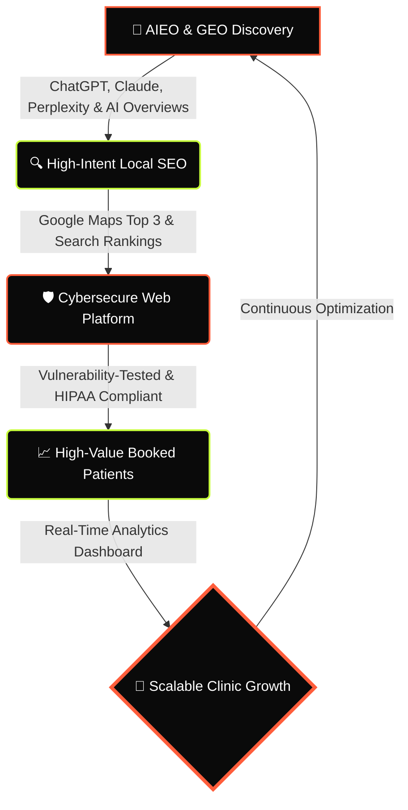

# <div align="center">⚖️ ADWEH</div>

<div align="center">
  
  **Healthcare's #1 Patient Acquisition & Growth Engine**

  [](https://github.com)
  [](https://vite.dev)
  [](https://react.dev)
  [](https://tailwindcss.com)
  [](https://netlify.com)

</div>

---

## <div align="center">🔄 The Patient Acquisition Engine</div>



---

## 👤 Executive Profile — Isaac Vivian (Founder)
> **"Business is less about intelligence and more about endurance. Most people never stay in the game long enough to discover what they’re truly capable of."**

Isaac Vivian is the Founder of **ADWEH**, a specialized growth advisory and technology partner for premium aesthetic and cosmetic healthcare clinics. ADWEH builds comprehensive digital discovery and web infrastructures that integrate AIEO, GEO, SEO, and cybersecurity-focused website development to deliver scalable, predictable patient growth.

---

## 🛠️ The Architecture & Systems

### 01. AIEO (Artificial Intelligence Engine Optimization)
Maximizing direct clinic citations, entity authority, and recommendations across leading conversational AI models including ChatGPT, Claude, and Perplexity.

### 02. GEO (Generative Engine Optimization)
Structuring medical answers, passage schemas, and factual attribution graphs to earn top snapshot placements in Google AI Overviews and Gemini syntheses.

### 03. SEO (Search Engine Optimization)
Dominating high-intent treatment keywords and local Google Maps top 3 rankings to capture active, qualified patient demand 24/7.

### 04. Website Development
High-performance digital infrastructure positioned around three foundational capabilities:
* **Cybersecurity-Focused Development:** Built using security-conscious development practices, encryption in transit, strict headers, and HIPAA compliance.
* **Secure Website Building and Testing:** Developed and audited to identify vulnerabilities, harden endpoints, and safeguard patient records.
* **SEO, AIEO, and GEO Optimization:** Engineered from the ground up for search engines, AI-powered search, and generative discovery.

---

## 🏆 Proven Results Delivered
| Metric | Achievement | Impact |
| :--- | :--- | :--- |
| **Qualified Leads** | **50+ Leads / Month** | Predictable booking pipeline |
| **Response Time** | **< 5 Minutes** | Instant patient engagement |
| **ROI** | **3.5x Average ROI** | Scalable practice growth |

---

## 🔒 Security & HIPAA Compliance
> [!IMPORTANT]
> **HIPAA-Compliant by Design**
> Every system, form, and database built by ADWEH is encrypted in transit and at rest to protect sensitive patient records and Protected Health Information (PHI).

* **Encrypted Lead Captures**: Standard secure SSL/TLS protocols for landing page forms.
* **Server-Side Configurations**: Deployment profiles enforce strict clickjacking protection (`X-Frame-Options`), MIME protection, and HTTPS redirection.

---

## 💻 Tech Stack & Deployment

* **Frontend Framework**: React (TypeScript) + Vite
* **Styling Engine**: Tailwind CSS
* **Build Optimization**: `vite-plugin-singlefile` (Compiles all styles/scripts into a single, high-performance static HTML file)

### Getting Started

1. **Install Dependencies**:
   ```bash
   npm install
   ```
2. **Launch Dev Server**:
   ```bash
   npm run dev
   ```
3. **Build Production Asset**:
   ```bash
   npm run build
   ```

---

<div align="center">
  <sub>Developed by ADWEH © 2026. All rights reserved.</sub>
</div>
